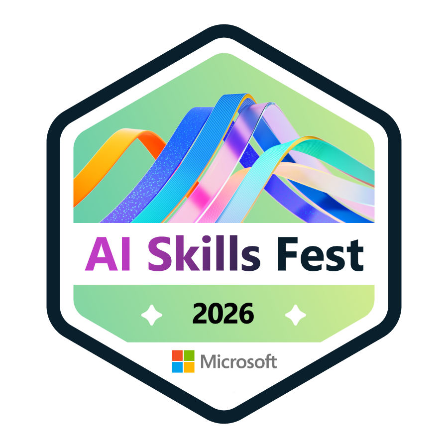

# 👋 Bonjour, je suis Youmnath MOUTAIROU

🎓 Étudiante ingénieure en **Intelligence Artificielle & Big Data** à **ESIGELEC**  
💼 **Recherche d'une alternance de 36 mois — disponibilité immédiate**  
📍 Poitiers, France · Mobilité nationale  
🔎 **Data & Business Intelligence · Développement logiciel · IA · Informatique industrielle**

  <a href="https://www.linkedin.com/in/youmnath-moutairou/"><strong>💼 Mon LinkedIn</strong></a> ·
  <a href="https://github.com/Youmnath"><strong>🐙 Mes dépôts GitHub</strong></a> ·
  <a href="#-me-contacter"><strong>📫 Me contacter</strong></a>

---

## 🧑‍💻 À propos de moi

Étudiante en cycle ingénieur à **ESIGELEC**, après deux années de classes préparatoires scientifiques MPSI, j'explore les liens entre **programmation, analyse de données et systèmes industriels**. J'aime comprendre un problème, construire une solution, la tester et apprendre de ses limites.

Mes projets vont d'une **boîte noire embarquée en C** à un **simulateur de robot sauveteur en Java**, en passant par des **rapports interactifs Power BI**. Mon immersion industrielle chez **SOBEBRA** m'a également sensibilisée aux enjeux de maintenance, de performance et de fiabilité.

> 🎯 Mon objectif : contribuer à des projets concrets en **Data/BI, développement logiciel ou transformation numérique industrielle**, tout en développant mes compétences en alternance.

## 🧭 Explorer mon portfolio

- [🚀 Projets et réalisations](#-projets-et-réalisations)
- [🛠️ Compétences](#️-compétences)
- [🏅 Microsoft Learn, badges et certifications](#-microsoft-learn-badges-et-certifications)
- [🏭 Expérience et distinctions](#-expérience-et-distinctions)
- [🎓 Formation et langues](#-formation-et-langues)
- [📫 Me contacter](#-me-contacter)

---

## 🚀 Projets et réalisations

### 🚗 BlackBox — Enregistreur de données embarqué en C

Projet de groupe : conservation des **10 dernières secondes** de mesures simulées d'un véhicule (vitesse, température moteur).

- Structures de données : **liste chaînée et buffer circulaire dynamique**
- Gestion mémoire : `malloc`, `calloc`, `free`
- Sauvegarde et lecture de données binaires ; tests de scénarios d'accélération, freinage et surchauffe

🔗 [Consulter mes dépôts]([https://github.com/Youmnath/BlackBoxProject](https://github.com/Youmnath/BlackBoxProject))

### 📊 Power BI — Analyse interactive des ventes

Rapport construit à partir de données de **clients, produits et commandes**, avec analyses par catégorie, produit et ville, dans le cadre de mon apprentissage des fondamentaux Data et de ma préparation à la **DP-900**.

**Outils :** Power BI · préparation et visualisation de données · filtres interactifs.

**Tâche :**
Conception d'un tableau de bord interactif pour analyser le chiffre d'affaires par catégorie de produits, la répartition des quantités vendues et les performances commerciales par ville avec Azure Maps.

🔗 [Consulter le projet et son tableau de bord](https://github.com/Youmnath/powerbi-analyse-ventes)

### 📈 Power BI — Dashboard in a Day

Parcours Microsoft Learn **Dashboard in a Day — Atelier en ligne**, terminé le **28 octobre 2026** : découverte de la préparation des données, de la modélisation, des hiérarchies, de DAX et de la création de rapports.

🔗 [Parcours Microsoft Learn](https://learn.microsoft.com/fr-fr/training/paths/dashboard-in-a-day/)

🔗 [Découvrir le projet](https://github.com/Youmnath/powerbi-dashboard-in-a-day)

### 🤖 Simulateur robotique — Robot sauveteur en Java

Projet réalisé à ESIGELEC : simulation de navigation et d'exploration, recherche de victimes, mémorisation de déplacements et tests.

**Techniques :** Java (en apprentissage) · tableaux 1D/2D · `ArrayList` · Eclipse · débogage · travail en équipe.

*À venir : dépôt documenté du projet.*

### 🏆 FIRST LEGO League — Robot autonome

Participation à la première édition nationale de la **FIRST LEGO League au Bénin** : conception et programmation d'un robot autonome, utilisation de capteurs, adaptation des stratégies et présentation devant un jury.

🏅 **Médaille obtenue avec mon équipe.**

### 🐍 Python — Progression Microsoft Learn

Parcours de prise en main de Python terminés en novembre 2026, avec pratique sous **Visual Studio Code** : fondamentaux, création de programmes et premières notions d'exploration et d'analyse de données.

*À venir : dépôt d'exercices personnels sélectionnés et commentés.*

---

## 🛠️ Compétences

- **Programmation :** C · Java (en apprentissage) · Python (fondamentaux, pratique débutante)
- **Data & BI :** Power BI · préparation et visualisation de données · tableaux de bord interactifs
- **Structures de données :** listes chaînées · buffers circulaires · tableaux · `ArrayList` · allocation dynamique
- **Outils :** Git · GitHub · VS Code · Eclipse · Code::Blocks · Microsoft Learn
- **Méthodes :** tests · débogage · analyse de problèmes · documentation · travail en équipe
- **En découverte :** services de données Microsoft Azure · concepts IA et Big Data

---

## 🏅 Microsoft Learn, badges et certifications

> **Note :** les badges et trophées Microsoft Learn attestent de réussites de formation ; ils ne sont pas présentés comme des certifications professionnelles. La **certification Azure Data Fundamentals (DP-900) est en préparation**.

### 🐍 Python et analyse de données

- 🏆 **Prise en main de la programmation Python : Partie 1 — Notions de base** · 01/11/2026
- 🏆 **Prise en main de la programmation Python : Partie 2 — Création de programmes** · 02/11/2026
- 🏅 **Explorer et analyser des données avec Python** · 03/11/2026

### 📊 Power BI et Business Intelligence

- 🏆 **Dashboard in a Day — Atelier en ligne** · 28/10/2026 · [Voir le parcours](https://learn.microsoft.com/fr-fr/training/paths/dashboard-in-a-day/)
- 🏅 **Créer votre premier modèle de données et explorer les données à l'aide de Power BI Desktop** · Microsoft Learn
- 🏅 **Utiliser des hiérarchies et DAX dans votre premier modèle de données** · Microsoft Learn

### ☁️ Azure et fondamentaux des données

- 🏆 **Introduction aux données relationnelles de Microsoft Azure Data dans Azure** · 03/10/2026
- 🏆 **Présentation des données non relationnelles de Microsoft Azure** · 03/10/2026
- 🏆 **Présentation de Microsoft Azure Data Analytics dans Azure** · 05/10/2026
- 📚 **Microsoft Azure Data Fundamentals (DP-900)** — *certification en préparation, examen non encore obtenu*

**Liens de partage Microsoft Learn à associer aux intitulés après vérification :**

- [Réussite FEN6P8AX](https://learn.microsoft.com/api/achievements/share/fr-fr/YoumnathMOUTAIROU/FEN6P8AX?sharingId=2E115415BC217EA0)
- [Réussite ABRGDX27](https://learn.microsoft.com/api/achievements/share/fr-fr/YoumnathMOUTAIROU/ABRGDX27?sharingId=2E115415BC217EA0)
- [Réussite EGQ4GBBP](https://learn.microsoft.com/api/achievements/share/fr-fr/YoumnathMOUTAIROU/EGQ4GBBP?sharingId=2E115415BC217EA0)
- [Réussite 2TZFXBNV](https://learn.microsoft.com/api/achievements/share/fr-fr/YoumnathMOUTAIROU/2TZFXBNV?sharingId=2E115415BC217EA0)

### 🏅 Microsoft — AI Skills Fest 2026

  

<a href="https://www.credly.com/badges/8f15d318-fa78-4f20-92b0-7a8a5ee187e6/public_url"><strong>Voir le badge vérifié sur Credly →</strong></a>

### 🤖 Intelligence artificielle

- [**IA générative**](./certifications/IA_g_n_rative_Certificate.pdf) — 27 septembre 2026
- [**L'IA pour tous**](./certifications/L_IA_pour_tous_Certificate.pdf) — 11 juillet 2026

### 📊 Données et outils numériques

- [**Gestion des données avec Microsoft 365**](./certifications/Gestion_des_donn_es_avec_Micro_Certificate.pdf) — 26 août 2026
- [**Create a Budget with Google Sheets**](https://coursera.org/verify/MT6VS6IRIQ64) — 27 juillet 2026
- [**Designing and Formatting a Presentation in PowerPoint**](https://coursera.org/verify/WQMB7R7UWDZ7) — 27 juillet 2026
- [**Getting Started with Microsoft OneDrive**](https://coursera.org/verify/AZ4NPBHUVU5K) — 27 juillet 2026
- [**Compétences Internet pour une utilisation quotidienne**](./certifications/Comp_tences_Internet_pour_une__Certificate.pdf) — 26 août 2026

---

## 🏭 Expérience et distinctions

**SOBEBRA — Stage d'immersion industrielle, Direction Technique** · Cotonou · Août 2025  
Découverte des activités de maintenance, production, automatisme et suivi de performance, avec sensibilisation aux enjeux QHSE et à la fiabilité des équipements.

**Distinctions :**
- 🥇 **Majore de promotion** en classes préparatoires scientifiques MPSI
- 🏅 **Médaille FIRST LEGO League** avec mon équipe, première édition nationale au Bénin

---

## 🎓 Formation et langues

**ESIGELEC — Cycle Ingénieur Généraliste**  
Filière Intelligence Artificielle & Big Data · **2026–2029** · Poitiers, France

**Cycle Préparatoire Père Aupiais — CPPA**  
Classes préparatoires scientifiques MPSI · **2024–2026** · Cotonou, Bénin

**Langues :** 🇫🇷 Français (langue maternelle) · 🇬🇧 Anglais (B2) · 🇪🇸 Espagnol (A1)

---

## 📫 Me contacter

- 💼 **LinkedIn :** [Youmnath MOUTAIROU](https://www.linkedin.com/in/youmnath-moutairou/)
- 🐙 **GitHub :** [github.com/Youmnath](https://github.com/Youmnath)
- ✉️ **E-mail professionnel :** *à ajouter après confirmation de l'adresse à rendre publique*

**Ouverte aux échanges autour d'une alternance de 36 mois, avec disponibilité immédiate.**

---

✨ Merci de votre visite ! N'hésitez pas à découvrir mes projets et à me contacter pour échanger.

